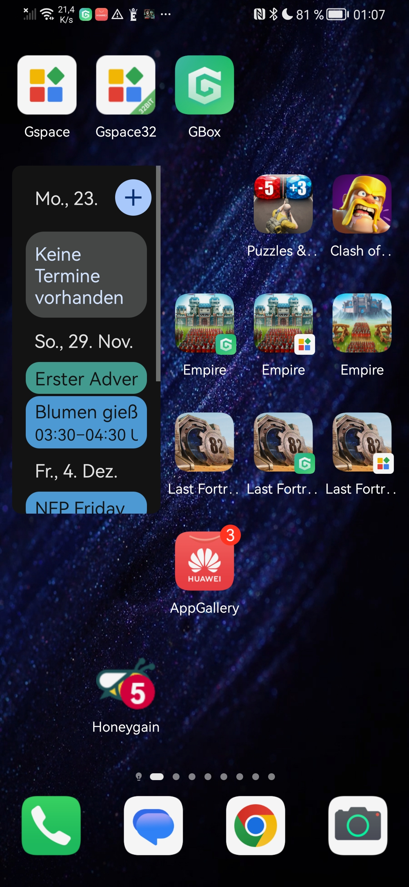
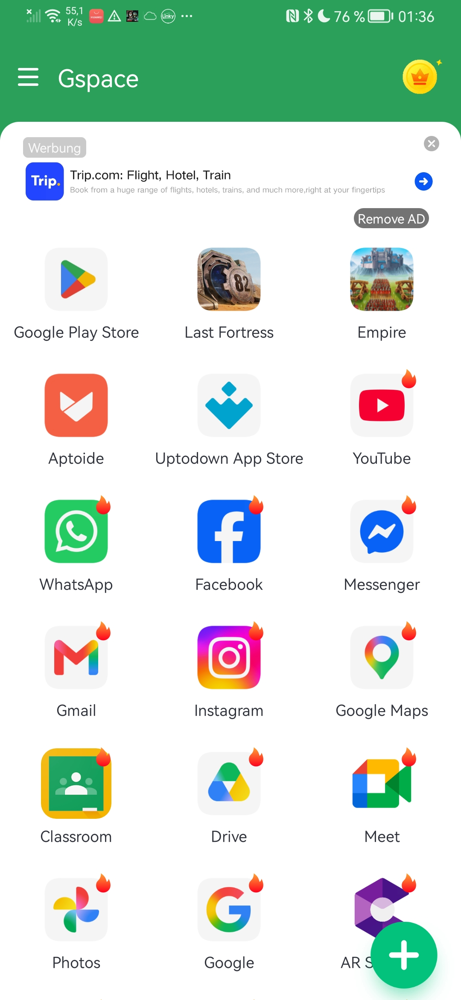

Ich hoffe, Du hast genügend Speicherplatz auf Deinem Android Gerät frei. 

In dem Du auf Huawei, die [Huawei AppGallerie](https://consumer.huawei.com/ru/mobileservices/appgallery/) einfach mit Deinem Browser downlädst und auf Deinem Android installierst. 
Da kannst Du mit Huaweis Appstore die App "Gspace" downloaden und nutzen. Die App Gspace 32 ist hierfür nicht notwendig.
Gspace ermöglicht es Dir sozusagen wie ein zweites Handy in Deinem Handy zu haben und zu nutzen. Ein zweiter Google Account das für Dich heißt. 
Damit kann man ganz einfach experimentieren. 
Oder so wie ich, sogar drei mal Last Fortress auf dem Gerät installiert haben. Da Huawei noch die Gbox kennt und hat, diese funktioniert allerdings nur auf Huawei Geräten. 
Jeweils mit einem anderen Google Account kannst Du Dein Handy nutzen. Siehe dazu mein Screenshot. 

## Gspace

Es befindet sich in der Gspace App ein eigener Google Playstore. Den kann man mit einer neuen Google Emailadresse anmelden und einrichten. 
Wir brauchen aber sicherlich noch einen VPN, um Google glauben zu machen, das wir in der USA sind. 

